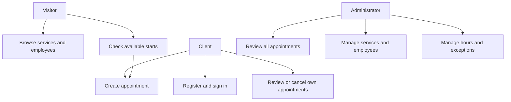
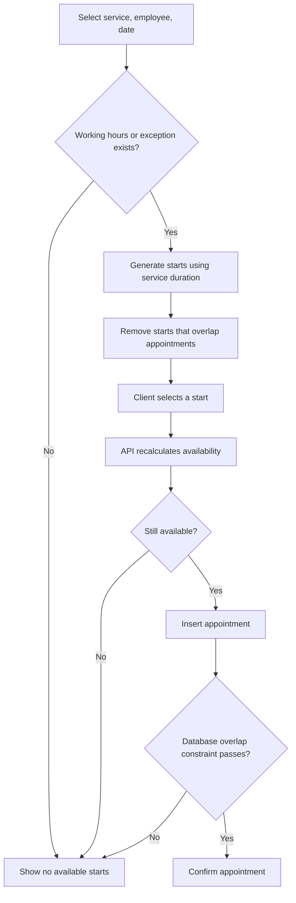
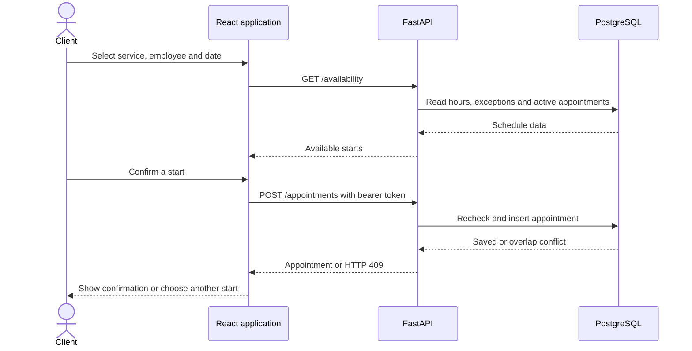
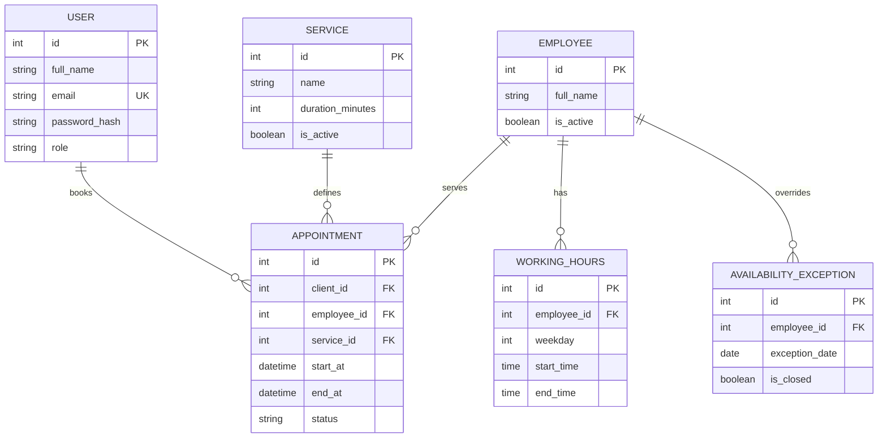
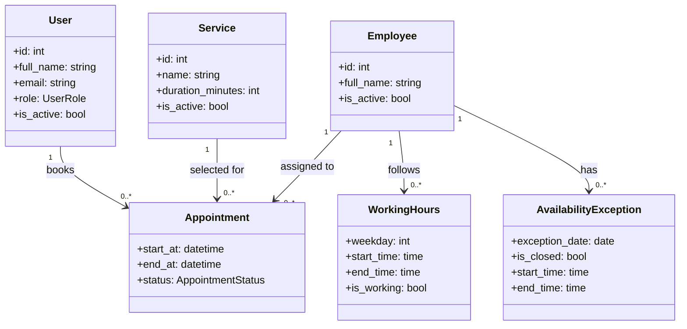

# Technical Design Baseline

## System boundary

The first version serves one configurable service organization. It supports client and administrator accounts, services, employees, weekly working hours, date-specific availability exceptions, and appointments. It does not process payments, send SMS messages, or provide a native mobile application.

## Actors and responsibilities

| Actor | Responsibilities |
| --- | --- |
| Visitor | Browse active services and employees; view available starts. |
| Client | Register, sign in, create and review personal appointments, cancel a personal appointment. |
| Administrator | Review all appointments; manage services and employees; set weekly hours and date exceptions. |

## Core functional requirements

1. The system allows a visitor to register with an email and password. Public registration always creates a client role.
2. The system authenticates users and distinguishes client and administrator permissions.
3. The system lists active services with their duration and active employees.
4. The system calculates available starts from the selected employee's working hours, service duration, exceptions, and existing appointments.
5. A client can reserve only an available start and can see and cancel their own appointments.
6. An administrator can review appointments and manage service, employee, working-hours, and exception records.
7. The system rejects overlapping active appointments for the same employee.

## Core nonfunctional requirements

- **Consistency:** the database is the authority for appointment persistence and overlap prevention.
- **Security:** passwords are stored as Argon2 hashes; protected API routes use signed bearer tokens; client registration cannot assign administrator privileges.
- **Privacy:** clients can read or cancel only their own appointments; the administrator can view all appointment details.
- **Usability:** the client booking flow exposes service, employee, date, and available starts before confirmation.
- **Maintainability:** frontend, API, domain models, and booking rules are separated into distinct modules.
- **Time correctness:** working hours are interpreted in the organization's configured IANA timezone and appointment timestamps are stored as timezone-aware instants.

## Data model

| Entity | Main attributes | Relationship / rule |
| --- | --- | --- |
| User | id, full_name, email, password_hash, role, is_active | One client can have many appointments. |
| Service | id, name, description, duration_minutes, is_active | One service can be used by many appointments. |
| Employee | id, full_name, is_active | Has weekly hours, date exceptions, and appointments. |
| WorkingHours | employee_id, weekday, start_time, end_time, is_working | At most one row per employee and weekday. |
| AvailabilityException | employee_id, exception_date, is_closed, optional start_time/end_time | At most one exception per employee and date; may close or override hours. |
| Appointment | client_id, employee_id, service_id, start_at, end_at, status | Connects one client, employee, and service; cancelled records do not block time. |

## Availability algorithm

1. Load the active employee and service and determine the organization's local date.
2. Check for an availability exception. A closed-day exception returns no starts. A custom-hours exception replaces that day's usual hours.
3. If no exception exists, load the employee's weekly hours for that weekday. A missing or non-working record returns no starts.
4. Convert the resulting local opening and closing times to timezone-aware instants.
5. Load active appointments that intersect that local workday.
6. Starting at opening time, generate candidates at 15-minute increments. Keep a candidate only when `candidate + service duration <= closing time` and its half-open interval does not intersect a booked appointment.
7. Before saving a booking, the API recalculates availability. The database exclusion constraint independently rejects concurrent overlapping inserts for the same employee.

Intervals use `[start, end)`. Therefore, a 10:00–10:30 booking and a 10:30–11:00 booking do not overlap.

## API outline

| Area | Routes |
| --- | --- |
| Authentication | `POST /auth/register`, `POST /auth/token`, `GET /auth/me` |
| Public catalogue | `GET /services`, `GET /employees`, `GET /availability` |
| Client bookings | `POST /appointments`, `GET /appointments/me`, `POST /appointments/{id}/cancel` |
| Administration | `GET /admin/appointments`, service and employee create/update routes, working-hours and exception routes |

## Key design decision: overlap prevention

An API-only availability check has a race condition: two clients may request the same time before either transaction commits. PostgreSQL's GiST exclusion constraint on `employee_id` and `tstzrange(start_at, end_at, '[)')` makes the database reject the second overlapping active appointment. The API translates that constraint failure into HTTP 409 Conflict.

## Design diagrams

### Use cases

### Booking activity

### Booking sequence

### Entity relationships

### Domain class diagram

## Planned evaluation evidence

The project can demonstrate success by creating a booking and showing it in the administrator view, rejecting an occupied start, allowing back-to-back non-overlapping starts, excluding cancelled appointments from availability, and applying regular hours and date exceptions. Functional and integration test cases should later be documented and executed against the agreed requirements.
